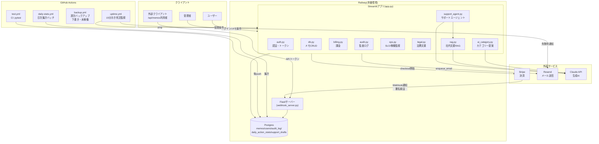

# アーキテクチャ図

第68課題で作成。これまで課題ごとに部分的な図(データフロー・SRE・脅威モデル等)は
作ってきたが、システム全体を1枚にまとめたものはまだ無かったので、今日作る。

## 全体構成

## 主なコンポーネントと役割

| コンポーネント | 役割 | 導入した課題 |
|---|---|---|
| `app.py` | メインのStreamlitアプリ(UI・ルーティング) | 初期〜継続 |
| `auth.py` | 認証、パスワードハッシュ、APIトークン発行 | 第3回〜 |
| `db.py` | メモのCRUD(テナント分離込み) | 初期 |
| `billing.py` | Stripe連携、プラン管理 | SaaS本体編 |
| `audit.py` | 監査ログの記録・集計 | 第45課題〜 |
| `ops.py` | 稼働率(SLI)・SLO・エラーバジェット | 第52・66課題 |
| `webhook_server.py` | Stripe Webhook受信・外部API(`/api/memos`) | 第46・47課題 |
| `ai_category.py` | メモのカテゴリー自動提案(構造化出力) | 第63課題 |
| `rag.py` | 社内文書に基づくQ&A(検索+生成) | 第64課題 |
| `support_agent.py` | 複数ステップの自律エージェント+評価 | 第65課題 |
| `migrate.py` | スキーマのバージョン管理 | 第28課題頃〜 |

## このシステムの設計上の特徴

- **単一のStreamlitプロセス + 別立てのFlaskサーバー**という2プロセス構成。
  決済Webhookのような「外部から直接叩かれる」経路だけFlaskに分離し、
  Streamlit側は人が操作する画面に専念させている。
- **外部APIはすべてurllib.request直書き**(SDKを追加しない)。小規模なAPI呼び出しが
  複数あるため、依存を増やさずHTTP層を自分でコントロールする方針で統一している。
- **新しいAI機能(第63〜65課題)は、既存のモジュール構成を崩さず追加**できている。
  `ai_category.py`・`rag.py`・`support_agent.py`はいずれもapp.pyから呼ばれるだけの
  独立モジュールで、既存のauth/db/billingとは依存しあっていない。

## 既知の制約

- Railway Free/Trialプランの予算制約から、外部メッセージブローカー(Redis/SQS)や
  Postgresの高可用性構成(レプリケーション)は導入していない(第59・60課題)。
- DB接続は全モジュール共通の単一ロール。最小権限の原則では分離が望ましいが、
  本番影響が大きいため未着手(第67課題で明記)。
