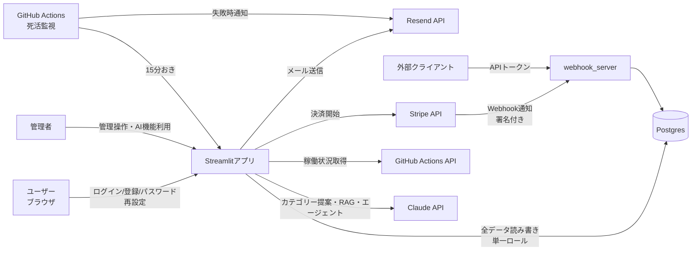

# 脅威モデル

第67課題で作成。独り立ち編(第45課題)で個別の脅威(IDOR)を見つけたのを、
今日はアプリ全体のデータの流れをもとに体系的に洗い直す。

## ① データの流れ図と脅威モデリング

各フローを「なりすまし(Spoofing)・改ざん(Tampering)・漏洩(Information
Disclosure)・妨害(Denial of Service)」の4観点で洗った。

| # | フロー | なりすまし | 改ざん | 漏洩 | 妨害 | 対策状況 |
|---|---|---|---|---|---|---|
| 1 | ユーザー→App(ログイン) | パスワード総当たり | — | — | ログイン連打 | ✅ bcrypt・5回/15分のレート制限(第45課題) |
| 2 | App→DB | — | SQLインジェクション | DB資格情報漏洩時に全データ | 大量クエリ | ✅ パラメータ化クエリ。⚠️全処理が単一のDBロールで、読み取り専用で足りる処理にも書き込み権限がある(最小権限になっていない、未対策) |
| 3 | App→Resend | — | — | 通信内容盗聴 | 送信枠の枯渇 | ✅ HTTPS。⚠️送信失敗は記録されるが(第66課題)、送信枠そのものの残量は見えない |
| 4 | Stripe→webhook_server | 偽Webhookの送信 | ペイロード改ざん | — | Webhook連打 | ✅ 署名検証(第46課題) |
| 5 | 外部→/api/memos | トークン盗用 | — | 他ユーザーのメモ漏洩(IDOR) | 連打 | ✅ ユーザー別トークン(第54課題で修正)・レート制限(第48課題) |
| 6 | App→GitHub API | — | — | — | APIレート制限枯渇 | ✅ 60秒キャッシュ(第52課題) |
| 7 | App→Claude API | — | プロンプトインジェクション(RAGに渡す社内文書経由) | APIキー漏洩時の悪用 | ボタン連打によるコスト爆発 | ✅ 呼び出しはボタン押下時のみ(第63〜65課題)。ユーザーごとの呼び出し回数上限を第72課題で追加(`AI_FEATURE_RATE_LIMIT`、全3機能に適用) |
| 8 | APIトークンの発行操作自体 | — | — | — | — | ❌ 発行操作が監査ログに残っていなかった(今回修正、下記③) |

## ② 最小権限とゼロトラストの点検

**既にゼロトラスト的にできている箇所**

- `webhook_server.py`(`/api/memos`・`/stripe/webhook`)はFlaskのステートレスな
  リクエスト処理のため、呼び出しのたびに毎回トークン/署名を検証している。
  「一度信用したら以後は信用する」ではなく、リクエスト単位で必ず確認する作りに
  自然となっている。
- `auth.authenticate()`は、ユーザー名が存在するかどうかに関わらず同じエラー文言を
  返し、`reset_password`も存在確認の有無で文言を変えない(列挙攻撃への配慮)。

**最小権限にできていない箇所(今回見つけた)**

- Streamlitアプリ側は`st.session_state.role`で管理者判定をしており、ログイン後は
  セッションが有効な間ずっと管理者権限が保持され続ける。明示的なセッションタイムアウトが
  無い。Streamlitの仕組み上、画面操作のたびにスクリプト全体が再実行されてロールを
  再チェックしてはいるが、それは「サーバー側のセッション状態を毎回読み直している」
  だけで、「本人確認をしている」わけではない。
- DB接続(`DATABASE_URL`)がアプリ全体で単一のロール。`rag.py`の検索のような
  読み取り専用で足りる処理にも、`memos`や`users`への書き込み権限を持つロールを
  使っている。本来はロールを分け、読み取り専用の処理には読み取り専用ロールを
  充てるのが最小権限の原則通り。

**今回は直さなかった理由**

DBロールの分離は、Railway上の本番Postgresに新しいロールを作成し、既存の全モジュールの
接続先を整理し直す必要があり、影響範囲が大きい。誤って必要な権限まで削ると本番が
止まるため、今日1日で安全に検証しきれる範囲を超えると判断し、見送った
(将来の課題として明記しておく)。

## ③ 実際に強化した対策

**監査ログ: APIトークン発行操作の記録漏れを修正**

`auth.generate_api_token()`は、資格情報(APIトークン)を発行する操作であるにも
関わらず、監査ログに一切記録していなかった。signup・login・password_resetなど、
他の認証系の操作はすべて記録されているのに、この操作だけ抜けていた。

もしAPIトークンが不正に使われた形跡(`api_memos_call`の異常な増加など)に
気づいても、「そのトークンがいつ・どのユーザーによって発行されたものか」を
`audit_log`から追えなかった。

`audit.log_action(username, "api_token_generated")`を追加し、発行のたびに
記録されるようにした。再発行(古いトークンの失効)も同じ経路を通るため、
再発行の履歴も残る。

実データでの確認: 本番の`audit_log`には現時点でまだ`api_token_generated`の
記録は無い(この修正はまだデプロイ前のため)。`tests/test_auth.py`で、発行・
再発行の両方が記録されることをテストデータで検証済み。
