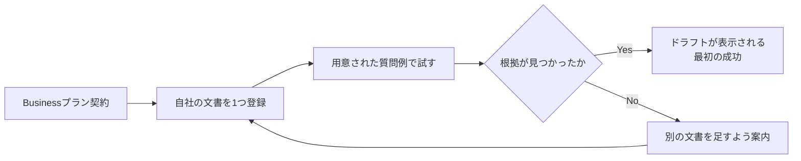

# 事業化設計: サポート回答エージェントを売る

第71課題で作成。第65課題で作った「サポート回答ドラフト・エージェント」
(`support_agent.py`)は、今は管理者だけが使える内部ツール。これを
外部の事業者に売る独立したプロダクトにするなら、という前提で設計する。

## ① 誰に・いくらで・どう課金するか

**誰に**

このアプリの運営(金子さん自身)のように、**自分の利用規約・FAQ・マニュアル
などの文書は持っているが、問い合わせ対応に人手を割けない小規模事業者**。
自社で使っている実績(今のPro会員向け管理ダッシュボード)がそのまま最初の
導入事例になる。

**いくらで**

既存プラン: Free(無料・月5件まで)・Pro(月額500円・無制限)。この上に
「Business」プランを追加する。

| 項目 | 金額 | 根拠 |
|---|---|---|
| Business | 月額1,980円 | 下記コスト試算の約4倍。粗利を確保しつつ、人を1人雇うより圧倒的に安いという価値提案にする |

**コスト試算(実測値ベース)**

- Claude API(Haiku、第63〜65課題で使用しているモデル): 1回の質問・回答で
  数百トークン程度。仮に月500回の問い合わせに答えるとしても、Haikuの
  料金体系では数百円〜千円程度(Anthropicの公開価格ベースの概算)。
- 既存のResend・Railwayのインフラ費用は、Proプランの会員が増えてもほぼ
  増加しない固定費に近い(第59課題で確認済み)。

1,980円であれば、月500件の問い合わせを捌いても十分な粗利が残る計算になる。

**どう課金するか**

既存の`billing.py`のStripe連携(Checkout + Webhook)をそのまま拡張する。
`users.plan`を`'free'` / `'pro'` / `'business'`の3値に広げ、新しい
`STRIPE_PRICE_ID_BUSINESS`を追加する。第68課題のADRの形式に倣い、
この拡張自体は今後`docs/adr/`に記録してから実装する(今日は設計のみ)。

## ② テナント分離とKPI

**テナント分離についての現状の制約(正直な注記)**

今の`rag.py`・`support_agent.py`は、**全ユーザー共通の1つの検索対象**
(`legal.py`の3文書)を前提にしている。これは「自社の管理者が自社の
規約について質問する」という内部ツールとしては正しい設計だったが、
**複数の契約者(他社)に売るなら、契約者ごとに別々の文書を検索対象にする
必要がある**。つまり「ユーザー単位」ではなく「契約者(テナント)単位」で
`RagIndex`を分ける設計に直す必要がある。これは今日実装せず、事業化に
進む場合の最初の技術的な前提条件として明記しておく。

**KPI(3つ、どれも今あるデータから実際に計測できるものを選んだ)**

1. **ドラフト採用率** — `support_agent.adoption_stats()`(今回追加)で計測。
   エージェントが作った下書きのうち、人がそのまま使える水準(`passed=True`)
   だった割合。「対応工数がどれだけ減ったか」の最も直接的な代理指標。
2. **Business転換率** — Pro会員のうち、Businessにアップグレードした割合。
   `billing.get_account_summary()`が返す`plan`の分布から計測できる。
3. **月間の質問対応件数の推移** — 第61課題の`daily_action_stats`の仕組みを
   応用し、`support_drafts`の日次件数を同じように集計すれば、
   「人手対応からAI対応への置き換わり」を時系列で追える。

## ③ 最初の成功までのオンボーディング導線

- **文書は1つから始められる**ようにする(全部揃えてから、だと着手が
  遅れる)。利用規約だけでも試せる。
- 質問例を**こちらから提示する**(空欄に何を打てばいいか分からない状態を
  作らない)。第64課題で実際に使った「支払いが遅れたらどうなりますか」の
  ような、文書の内容に即した例文を契約直後に出す。
- 根拠が見つからなかった場合に「失敗」で終わらせず、「文書を足してください」
  という次の行動に必ずつなげる(第70課題の伴走の言葉の姿勢と同じ:
  つまずきをそのまま放置しない)。
